<!--
  Archivo generado por build.py: no lo edites a mano.
  Para cambiar textos o enlaces, edita CONTENT en build.py: GitHub Actions lo regenera solo
  (o ejecútalo tú con  python3 build.py)
-->

  <picture><source media="(max-width: 600px)" srcset="./assets/banner-mobile.svg"><source media="(prefers-color-scheme: dark)" srcset="./assets/banner-dark.svg"></picture>

  <a href="https://www.linkedin.com/in/jorge-ramos-tellez"><picture><source media="(prefers-color-scheme: dark)" srcset="./assets/link-1-dark.svg"></picture></a>
  <a href="https://github.com/JorgeRamos-UX/Portafolio-UX"><picture><source media="(prefers-color-scheme: dark)" srcset="./assets/link-2-dark.svg"></picture></a>

 

  <picture><source media="(max-width: 600px)" srcset="./assets/h-about-mobile.svg"><source media="(prefers-color-scheme: dark)" srcset="./assets/h-about-dark.svg"></picture>

I'm a **Product UX designer with an engineer's mind**. I trained in Cybernetic Electronics Engineering, so I start with how the system works, and only then design the screen.

I design products end to end, and the tools that help teams build them well: design systems, Design Ops and AI agents. At **[Hexalis](https://hexalis.org/en/)**, an open source nonprofit, I'm the product designer behind its Design System and Design Ops Toolkit.

  <picture><source media="(max-width: 600px)" srcset="./assets/layers-head-mobile.svg"><source media="(prefers-color-scheme: dark)" srcset="./assets/layers-head-dark.svg"></picture>

<picture><source media="(max-width: 600px)" srcset="./assets/layer-1-mobile.svg"><source media="(prefers-color-scheme: dark)" srcset="./assets/layer-1-dark.svg"></picture>

  <picture><source media="(max-width: 600px)" srcset="./assets/inspect-1-mobile.svg"><source media="(prefers-color-scheme: dark)" srcset="./assets/inspect-1-dark.svg">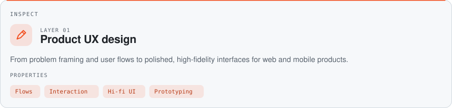</picture>

<picture><source media="(max-width: 600px)" srcset="./assets/layer-2-mobile.svg"><source media="(prefers-color-scheme: dark)" srcset="./assets/layer-2-dark.svg"></picture>

  <picture><source media="(max-width: 600px)" srcset="./assets/inspect-2-mobile.svg"><source media="(prefers-color-scheme: dark)" srcset="./assets/inspect-2-dark.svg">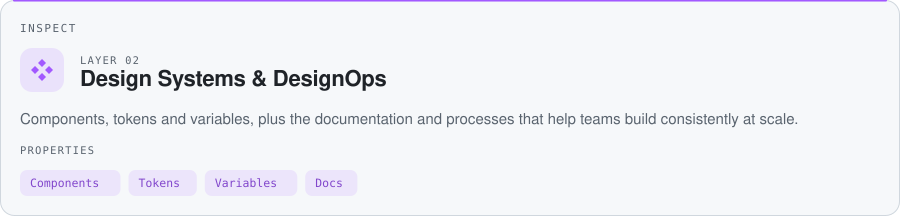</picture>

<picture><source media="(max-width: 600px)" srcset="./assets/layer-3-mobile.svg"><source media="(prefers-color-scheme: dark)" srcset="./assets/layer-3-dark.svg"></picture>

  <picture><source media="(max-width: 600px)" srcset="./assets/inspect-3-mobile.svg"><source media="(prefers-color-scheme: dark)" srcset="./assets/inspect-3-dark.svg">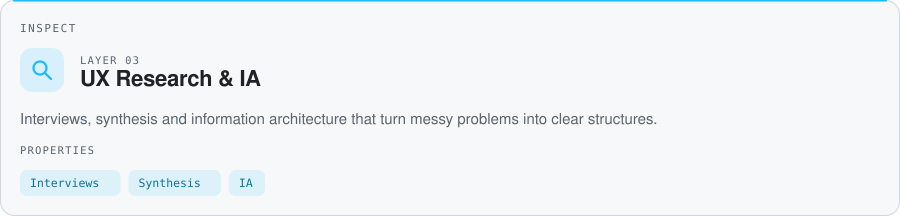</picture>

<picture><source media="(max-width: 600px)" srcset="./assets/layer-4-mobile.svg"><source media="(prefers-color-scheme: dark)" srcset="./assets/layer-4-dark.svg"></picture>

  <picture><source media="(max-width: 600px)" srcset="./assets/inspect-4-mobile.svg"><source media="(prefers-color-scheme: dark)" srcset="./assets/inspect-4-dark.svg">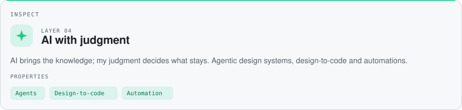</picture>

 

  <picture><source media="(max-width: 600px)" srcset="./assets/h-portfolio-mobile.svg"><source media="(prefers-color-scheme: dark)" srcset="./assets/h-portfolio-dark.svg">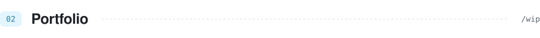</picture>

  <a href="https://github.com/JorgeRamos-UX/Portafolio-UX"><picture><source media="(max-width: 600px)" srcset="./assets/portfolio-mobile.svg"><source media="(prefers-color-scheme: dark)" srcset="./assets/portfolio-dark.svg"></picture></a>

Meanwhile: <a href="https://milanko.hexalis.org/">Milanko</a> is live (made at Hexalis for the NASA Space Apps Challenge 2026; not an official NASA app nor endorsed by NASA) and the <a href="https://hexalis.org/en/#sistema">Hexalis libraries</a> are open source.

 

  <picture><source media="(max-width: 600px)" srcset="./assets/h-method-mobile.svg"><source media="(prefers-color-scheme: dark)" srcset="./assets/h-method-dark.svg"></picture>

  <picture><source media="(max-width: 600px)" srcset="./assets/method-mobile.svg"><source media="(prefers-color-scheme: dark)" srcset="./assets/method-dark.svg"></picture>

 

  <picture><source media="(max-width: 600px)" srcset="./assets/h-system-mobile.svg"><source media="(prefers-color-scheme: dark)" srcset="./assets/h-system-dark.svg">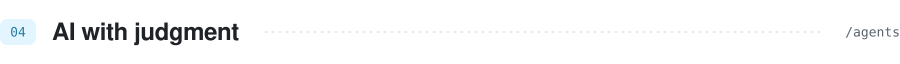</picture>

  <picture><source media="(max-width: 600px)" srcset="./assets/system-mobile.svg"><source media="(prefers-color-scheme: dark)" srcset="./assets/system-dark.svg"></picture>

  <picture><source media="(max-width: 600px)" srcset="./assets/rules-mobile.svg"><source media="(prefers-color-scheme: dark)" srcset="./assets/rules-dark.svg"></picture>

AI brings the knowledge; my judgment decides what stays. The agent is a concept I'm exploring; the three rules come from ATLAS, my thesis product. The tokens it uses are real — the same ones that draw this page, exported to <a href="./tokens.json"><code>tokens.json</code></a>.

 

  <picture><source media="(max-width: 600px)" srcset="./assets/h-exploring-mobile.svg"><source media="(prefers-color-scheme: dark)" srcset="./assets/h-exploring-dark.svg"></picture>

  <picture><source media="(max-width: 600px)" srcset="./assets/exploring-mobile.svg"><source media="(prefers-color-scheme: dark)" srcset="./assets/exploring-dark.svg"></picture>

 

<b>What decision is your team weighing right now?</b> 
<a href="https://www.linkedin.com/in/jorge-ramos-tellez">Message me on LinkedIn</a> · <a href="https://github.com/JorgeRamos-UX/Portafolio-UX">Follow the portfolio build</a>

 

  <picture><source media="(max-width: 600px)" srcset="./assets/footer-mobile.svg"><source media="(prefers-color-scheme: dark)" srcset="./assets/footer-dark.svg"></picture>

