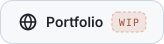
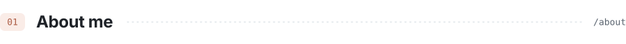
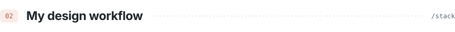
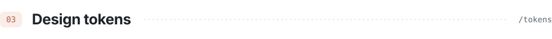
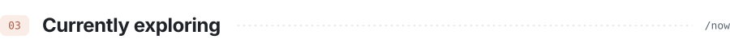

<!--
  Archivo generado por build.py: no lo edites a mano.
  Para cambiar textos o enlaces, edita CONTENT en build.py: GitHub Actions lo regenera solo
  (o ejecútalo tú con  python3 build.py)
-->

  <picture><source media="(max-width: 600px)" srcset="./assets/banner-mobile.svg"><source media="(prefers-color-scheme: dark)" srcset="./assets/banner-dark.svg"></picture>

  <a href="mailto:jorgeramos201003@gmail.com"><picture><source media="(prefers-color-scheme: dark)" srcset="./assets/link-1-dark.svg"></picture></a>
  <a href="https://www.linkedin.com/in/jorge-ramos-tellez"><picture><source media="(prefers-color-scheme: dark)" srcset="./assets/link-2-dark.svg"></picture></a>

 

  <picture><source media="(max-width: 600px)" srcset="./assets/h-about-mobile.svg"><source media="(prefers-color-scheme: dark)" srcset="./assets/h-about-dark.svg"></picture>

I'm a **Product Designer and Cybernetics Engineer** working in the **financial sector**, where I combine UX, UI, product thinking and design operations to turn complex problems into clear, scalable experiences.

  <picture><source media="(max-width: 600px)" srcset="./assets/about-mobile.svg"><source media="(prefers-color-scheme: dark)" srcset="./assets/about-dark.svg"></picture>

 

  <picture><source media="(max-width: 600px)" srcset="./assets/h-workflow-mobile.svg"><source media="(prefers-color-scheme: dark)" srcset="./assets/h-workflow-dark.svg"></picture>

  <picture><source media="(max-width: 600px)" srcset="./assets/workflow-mobile.svg"><source media="(prefers-color-scheme: dark)" srcset="./assets/workflow-dark.svg"></picture>

 

  <picture><source media="(max-width: 600px)" srcset="./assets/h-tokens-mobile.svg"><source media="(prefers-color-scheme: dark)" srcset="./assets/h-tokens-dark.svg"></picture>

  <picture><source media="(max-width: 600px)" srcset="./assets/tokens-mobile.svg"><source media="(prefers-color-scheme: dark)" srcset="./assets/tokens-dark.svg"></picture>

The tokens behind this page, exported as <a href="./tokens.json"><code>tokens.json</code></a> (W3C Design Tokens format) by the same script that draws it.

 

  <picture><source media="(max-width: 600px)" srcset="./assets/h-exploring-mobile.svg"><source media="(prefers-color-scheme: dark)" srcset="./assets/h-exploring-dark.svg"></picture>

  <picture><source media="(max-width: 600px)" srcset="./assets/exploring-mobile.svg"><source media="(prefers-color-scheme: dark)" srcset="./assets/exploring-dark.svg"></picture>

 

  <picture><source media="(max-width: 600px)" srcset="./assets/footer-mobile.svg"><source media="(prefers-color-scheme: dark)" srcset="./assets/footer-dark.svg"></picture>

